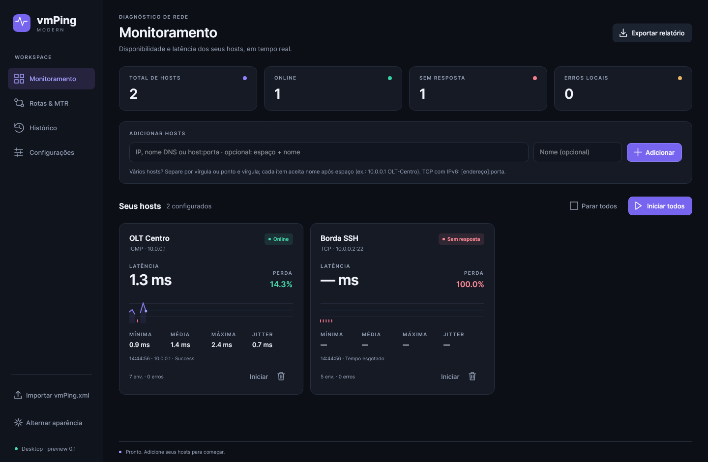
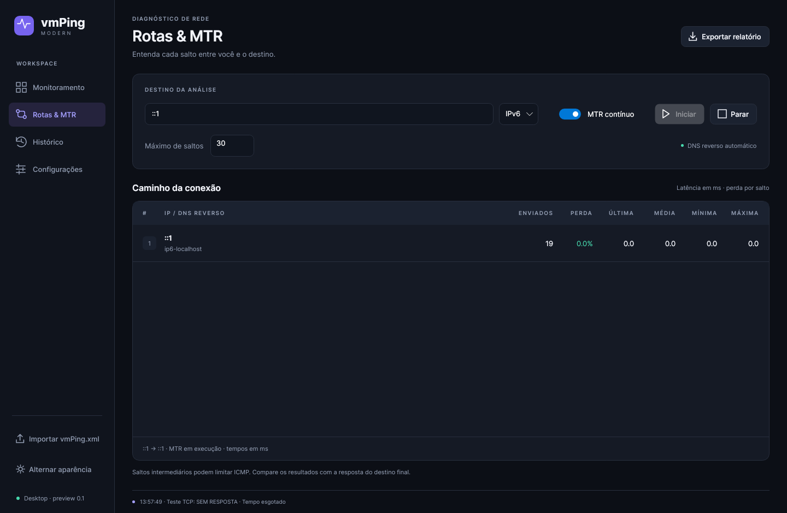

# vmPing Modern

Monitor de rede multi-host para **Windows e Linux**, em português, feito para o dia a dia de provedor: ping ICMP e TCP em vários hosts ao mesmo tempo, traceroute/MTR com DNS reverso e alertas no Telegram.

Reescrita em .NET 10 + Avalonia, inspirada no [vmPing de Ryan Smith](https://github.com/r-smith/vmPing).



## Download

### **[⬇ Baixar vmPing-modern.exe (Windows)](https://github.com/CarHen17/VM-PING-/releases/latest/download/vmPing-modern.exe)**

Arquivo único, sem instalador: baixe e execute. O runtime .NET já vem embutido.

Outras opções em **[Releases](https://github.com/CarHen17/VM-PING-/releases/latest)**:

- **Linux x64 (arquivo único):** [`vmPing-modern-linux`](https://github.com/CarHen17/VM-PING-/releases/latest/download/vmPing-modern-linux) → `chmod +x vmPing-modern-linux && ./vmPing-modern-linux`
- **Windows x64 (pasta):** `vmPing-modern-windows-x64.zip` → extraia e abra `vmPing-modern.exe`
- **Linux x64 (pasta):** `vmPing-modern-linux-x64.tar.gz` → extraia e execute `./vmPing-modern`

O executável ainda não tem assinatura digital: o Windows SmartScreen pode avisar na primeira execução (**Mais informações → Executar assim mesmo**). Confira o hash em `SHA256SUMS.txt`.

## Recursos

- Monitoramento ICMP e TCP (`host:porta`) simultâneo, IPv4/IPv6 e nomes DNS
- Latência com precisão abaixo de 1 ms, perda, mín/média/máx e **jitter** por host, gráfico das últimas 60 sondagens
- **Histerese**: host só fica offline após N falhas seguidas (configurável) — sem alerta falso por perda isolada
- **Alertas no Telegram** quando um host cai ou volta, agrupados quando vários caem juntos (ex.: POP inteiro)
- **Traceroute e MTR contínuo** com DNS reverso e detecção de **ECMP** (vários roteadores por salto)
- Inclusão em lote com nome: `10.0.0.1 OLT-Centro, 10.0.0.2 OLT-Norte`
- Favoritos (conjuntos de hosts), histórico salvo em disco, exportação CSV
- Temas claro e escuro; importa favoritos e aliases do `vmPing.xml` original




## Documentação e desenvolvimento

Detalhes de uso, limitações e build em [`modern/README.md`](modern/README.md).

```bash
cd modern
dotnet test VmPing.Modern.slnx -c Release
dotnet run --project src/VmPing.Desktop
```

## Créditos e licença

Licença MIT — veja [LICENSE](LICENSE). Baseado no vmPing, Copyright (c) 2020 Ryan Smith. O código WPF original está preservado em [`vmPing/`](vmPing/) (README original em [`vmPing/README-original.md`](vmPing/README-original.md)).
